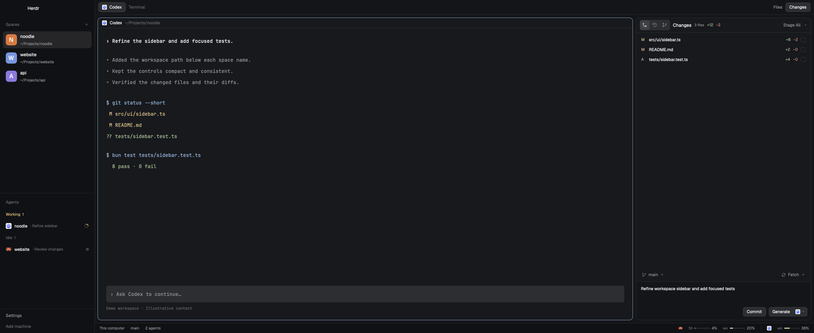

# Herdr Noodle

A compact Herdr layout for coding agents, browsing files, reviewing Git changes, and generating commit messages through your existing AI connections.

## Install

Paste this prompt into a coding agent running inside Herdr:

```text
Read ~/.config/herdr-app/AGENTS.md, then add this layout: https://github.com/wilfredinni/herdr-noodle
```

The agent reads [RECIPE.md](RECIPE.md) and the included files, follows Herdr's installation instructions, handles name conflicts, validates the mods, and switches to `noodle`.

Requirements: Herdr **0.1.15** (the tested version), Git, and Python **3.9+**. `bash` and `bat` are optional for syntax-colored previews; source and diffs still open without `bat`. AI features require a supported installed and signed-in CLI.



- Spaces show a robot icon and their open-agent count below the name, beside a two-line initial avatar.
- Files have Git status colors and file-type icons. Files, diffs, and rendered Markdown open beside your terminal.
- Changes, History, Graph, and Stash share labeled tabs. Staged and working changes have separate collapsible groups and previews; partially staged files appear in both. File menus are available by right-click or the row's ellipsis.
- The repository heading has its own actions menu. History and Graph use compact tables; Graph adds lanes and inline refs. History marks unpushed commits with an upward arrow, based on the tracked remote's last fetched refs. Hover for the remote branch; unknown/local-only upstreams have no status claim. Stash supports real diff previews, Apply, Pop and confirmed Drop; a failed Pop keeps the stash.
- The branch toolbar shows **Pull (N)** for incoming commits, **Push (N)** for outgoing commits, or **Fetch** when caught up. Counts use local upstream refs; Fetch remains in the menu. If both directions have commits, Pull takes priority and uses fast-forward only.
- When the folder contains multiple repositories, the repository title opens a selector with branches, changed-file counts, sync state, conflicts and Refresh. A single child repository opens automatically with a plain title. Select a repository to scope every Git action and preview; each repository keeps its commit draft. **Follow terminal** returns to the terminal's repository.
- A borderless three-line commit area has matching **Commit all** / **Commit N files** and **Generate** controls. Choose a connection, then its available model. Unresolved conflicts disable Commit and Generate.
- Below the buttons, the latest commit message opens its details. Its Undo button confirms a local soft reset to the first parent, keeping the index and working files unchanged. It restores the old message only when the draft is still empty, and refuses a changed HEAD. Initial commits have no parent and cannot be undone here. Remote history is unchanged.
- The footer shows compact subscription usage meters with consistent green, warning, and red colors.

Working-file previews ignore unrelated folder changes and defer refreshes while their tab is hidden.
The shared preview includes Diff, Source and rendered Markdown tabs, unified or aligned split diffs,
both line numbers, file statistics, copying paths and file history. History/Graph previews include
the full commit message, author, parents and file chips; switching files keeps the selected commit.
The file menu stages, unstages, ignores and confirms discarding or moving untracked files to Trash.
Conflict review offers current, incoming or both versions, followed by an explicit resolve-and-stage
confirmation. It rejects changed content, index or HEAD; binary, large and malformed conflicts need
an external editor. Historical previews never offer mutations.
Unchanged source and diffs reuse syntax colors. Files reuses tracked paths while the local Git index
checksum is unchanged; remote or unreadable indexes keep fresh Git reads. OpenCode usage reads
connections and quotas without calculating spending statistics.

Repository discovery scans the focused terminal's folder at most four levels deep, skips dependency/build
folders and directory symlinks, and recognizes `.git` directories and files (worktrees/submodules).
It refreshes once a minute or on request, with limits of 2,000 directories, 64 repositories,
and eight seconds. Refresh's tooltip reports incomplete searches and unreadable status; open a closer
folder when the workspace exceeds those limits. It does not fetch remotes to calculate sync state.

The preview uses fictional demo content rather than anyone's workspaces, terminal history, credentials, or account usage.

## Commit behavior

Checkboxes represent the real Git index, not a separate selection. With checked files, Commit uses their staged content and preserves unstaged hunks. With nothing checked, Commit stages and commits all changed files in the reviewed file list, including new files and deletions. A message is required.

Generate follows the same scope: checked files use their staged changes; no checked files includes all working changes. It only fills the text area. It does not stage files or commit. A changed draft, repository, branch, or selection prevents an obsolete result from replacing your current work. Diffs include one context line per hunk and allow up to 120,000 UTF-8 bytes. OpenCode's encoded request body also has a 120,000-byte limit because its CLI uses a command-line argument. Errors report the actual size; stage a smaller selection when it exceeds the limit. Source is never silently truncated.

Only Generate spins during generation. Fetch spins for actions from Fetch and its menu, including Pull and Push. Selecting files and switching branches leave those indicators still.

## Connections and access

Usage reads the CLI sign-ins for Codex, Claude, OpenCode, and Kiro. Missing installations are grouped at the end of the usage popup. Kiro reads monthly credits and the reset date through its V2 `/usage` command, tested with an IAM Identity Center KIRO POWER account. Its text format and Claude's internal usage interface can change. Kiro may save an empty CLI session per refresh. API estimates and account classification are not displayed.

Commit generation supports native Codex and the connected model providers exposed by OpenCode, including **OpenCode Go**. It discovers models instead of bundling a fixed catalog, remembers the selection, and does not silently switch accounts or models. Claude and Kiro generation adapters are not implemented. Tested with Codex CLI **0.167.2** and OpenCode **2.2.7**; provider interfaces and quota availability depend on the installed CLI version.

The usage collector runs Python and the installed CLIs, and those CLIs may contact their providers. Generate sends the selected diff to the connection you choose. Codex runs an ephemeral, read-only invocation from a neutral temporary folder with tool features disabled. OpenCode uses its stateless text-generation endpoint. Its current CLI accepts the request body through process arguments, so the prompt can be visible to local process inspection while running.

Git actions run normal Git commands and honor your repository hooks, signing, remotes, and authentication. Pull, Push, branch switching, staging, commits, stash operations, and the explicitly confirmed restore/discard actions modify your repository. Trash actions use recoverable system Trash on macOS and Linux. Windows has no Trash adapter here. The file browser and preview read the focused folder and its Git content. Nothing in this repository contains your credentials or account data.

See [the connection notes](mods/workspace-usage/CONNECTIONS.md) and [source provenance](NOTICE.md).

## Validate

```sh
python3 -m unittest discover -s tests -p 'test_*.py'
node --test tests/*.test.cjs
for mod in mods/*; do herdr-app check "$mod"; done
```

Python checks cover the package and generation scope. Node is needed only for development tests. Commit tests use disposable repositories and do not call AI providers. Herdr's check validates the initial render; also exercise the installed layout in the app.

Switch back with `herdr-app do layout.switch '{"name":"main"}'`. To uninstall, switch away first, then remove only the `noodle` layout/preview and the six mods you installed after checking that no other layout uses them. These files are listed in [manifest.json](manifest.json).

## Sharing

The repository is [wilfredinni/herdr-noodle](https://github.com/wilfredinni/herdr-noodle). Add the topic **`herdr-layout`** on GitHub to make it discoverable through Herdr's layout directory. Publication, repository visibility, and licensing are decisions for the repository owner. No global settings or runtime state belong in the bundle.
