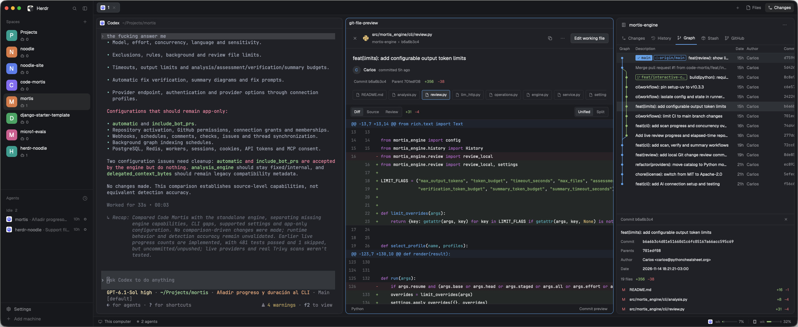

# Herdr Noodle

A compact Herdr layout for coding agents, browsing files, reviewing Git changes, and generating commit messages through your existing AI connections.

## Install

Paste this prompt into a coding agent running inside Herdr:

```text
Read ~/.config/herdr-app/AGENTS.md, then install https://github.com/wilfredinni/herdr-noodle following its INSTALL.md, RECIPE.md and complete manifest.json, including helpers/noodle/.
```

The agent follows [INSTALL.md](INSTALL.md), [RECIPE.md](RECIPE.md) and the included files, checks name conflicts before copying, installs the layout, Settings thumbnail, seven mods and **all of `helpers/noodle/`**, validates the installed files, and switches to `noodle`. Use the actual Herdr home if `HERDR_APP_HOME` overrides the usual path. Global settings, keys, sign-ins and runtime state are not copied.

Tested on **macOS with Herdr 0.1.15**. Required: Git, Python **3.9+**, and ripgrep (`rg`) for Quick Open/content search. `bash` and `bat` are optional for syntax-colored previews; source and diffs still open without them. PR / CI requires an installed, signed-in `gh`; AI features require a supported installed and signed-in CLI. No pip packages are required. Linux image previews and Reveal in Finder are unavailable with the current macOS adapters; Windows is unsupported by the full package because shared helpers require Unix APIs. See [platform details](INSTALL.md#requirements).



- Spaces show a robot icon and their open-agent count below the name, beside a two-line initial avatar.
- Files have Git status colors and file-type icons. Files opens a separate editor beside your terminal, with syntax highlighting and ⌘S / Ctrl+S to save. Changes and its tabs keep their diff preview.
- Changes, History, Graph, Stash, and GitHub share labeled tabs. Staged and working changes have separate collapsible groups and previews; partially staged files appear in both. File menus are available by right-click or the row's ellipsis. Above 80 changed files, Changes uses 50-row pages; group staging still applies to the whole group. Large file trees and commit lists render only visible rows.
- GitHub keeps **Pull requests** and **Workflows** in the sidebar, scoped to the selected repository. Filter PRs by title, number, author or branch. Select a row to open a reusable preview beside the terminal while the list stays visible. PR previews keep their identity above **Overview**, **Checks** and **Reviews** tabs; copy individual reviews or unresolved threads with their authors, file locations and links. Workflow previews show jobs, steps and bounded logs with copying and GitHub links. Publish/push, then use **New PR** to compose an editable title and description, optionally as a draft.
- The repository heading has its own actions menu. History and Graph use compact tables; Graph adds lanes and inline refs. History marks unpushed commits with an upward arrow, based on the tracked remote's last fetched refs. Hover for the remote branch; unknown/local-only upstreams have no status claim. Stash supports real diff previews, Apply, Pop and confirmed Drop; a failed Pop keeps the stash.
- The branch toolbar shows **Publish** for a committed branch without an available upstream, **Pull (N)** for incoming commits, **Push (N)** for outgoing commits, or **Fetch** when caught up. Publish creates the remote branch and sets its upstream. It honors Git's configured push remote, otherwise uses origin or a sole remote, and asks when the destination is ambiguous. Counts use local upstream refs; Fetch remains in the menu. If both directions have commits, Pull takes priority and uses fast-forward only.
- A worktree selector appears before the branch selector. Filter and select an existing checkout to scope Changes and Files to it, preserving commit drafts per checkout. **New worktree…** opens Herdr's creation dialog.
- When the folder contains multiple repositories, the repository title opens a selector with branches, changed-file counts, sync state, conflicts and Refresh. A single child repository opens automatically with a plain title. Select a repository to scope every Git action and preview; each repository keeps its commit draft. **Follow terminal** returns to the terminal's repository.
- A borderless three-line commit area has matching **Commit all** / **Commit N files** and **Generate** controls. Choose a connection, then its available model. Unresolved conflicts disable Commit and Generate.
- Below the buttons, the latest commit message opens its details. Its Undo button confirms a local soft reset to the first parent, keeping the index and working files unchanged. It restores the old message only when the draft is still empty, and refuses a changed HEAD. Initial commits have no parent and cannot be undone here. Remote history is unchanged.
- The footer shows compact subscription usage meters with consistent green, warning, and red colors.

The file editor supports local UTF-8 text files up to 1 MiB. It keeps recovery drafts and refuses to overwrite external edits until you review the saved version. Remote files and binary files cannot be edited.

Working-file previews ignore unrelated folder changes and defer refreshes while their tab is hidden.
The Changes preview includes Diff, Source and rendered Markdown tabs, unified or aligned split diffs,
both line numbers, file statistics, copying paths and file history. History/Graph previews include
the full commit message, author, parents and file chips; switching files keeps the selected commit.
The file menu stages, unstages, ignores and confirms discarding or moving untracked files to Trash.
Conflict review offers current, incoming or both versions, followed by an explicit resolve-and-stage
confirmation. It rejects changed content, index or HEAD; binary, large and malformed conflicts need
an external editor. Historical previews never offer mutations.
Unchanged source and diffs reuse syntax colors. Files reuses tracked paths while the local Git index
checksum is unchanged; remote or unreadable indexes keep fresh Git reads. OpenCode usage reads
connections and quotas without calculating spending statistics.

Repository discovery scans the focused terminal's folder at most four levels deep, skips dependency/build
folders and directory symlinks, and recognizes `.git` directories and files (worktrees/submodules).
It refreshes once a minute or on request, with limits of 2,000 directories, 64 repositories,
and eight seconds. Refresh's tooltip reports incomplete searches and unreadable status; open a closer
folder when the workspace exceeds those limits. It does not fetch remotes to calculate sync state.

Both preview images use fictional demo content rather than anyone's workspaces, terminal history, credentials, or account usage. They illustrate the layout and do not depict every current control.

## Commit behavior

Checkboxes represent the real Git index, not a separate selection. With checked files, Commit uses their staged content and preserves unstaged hunks. With nothing checked, Commit stages and commits all changed files in the reviewed file list, including new files and deletions. A message is required.

Generate follows the same scope: checked files use their staged changes; no checked files includes all working changes. It only fills the text area. It does not stage files or commit. A changed draft, repository, branch, or selection prevents an obsolete result from replacing your current work. Diffs include one context line per hunk and allow up to 1,200,000 UTF-8 bytes. OpenCode's encoded request body also allows 1,200,000 bytes and goes directly to its authenticated local service, avoiding command-line argument limits. Errors report the actual size; stage a smaller selection when it exceeds the limit. Source is never silently truncated.

The **Commit instructions** icon before Commit and Generate opens a text area for your preferred style, language and conventions. Save applies the instructions to future generations; the × closes without saving. Instructions are stored in Herdr's local state per repository and machine, and are sent with the selected diff to the chosen connection. Leave them empty to use the default English imperative style. Generated messages remain single-line commit subjects.

Only Generate spins during generation. Fetch spins for actions from Fetch and its menu, including Pull and Push. Selecting files and switching branches leave those indicators still.

## Connections and access

The GitHub tab uses the installed, authenticated `gh`, including GitHub Enterprise hosts selected by the CLI. **New PR** has its own Generate button, using the same connection/model selection as commits. The settings icon immediately before Generate opens **PR instructions** and a template file path, stored separately per repository and machine. Choose a detected template or enter a relative/absolute UTF-8 text file path. Generation uses committed changes and commit history against the chosen base, never staged or unstaged work. Fetch the base branch first if its commit is not available locally. Generated text remains editable; only **Create PR** submits it. Creation checks that the published branch matches local HEAD and checks for an existing PR before retrying. It does not push implicitly.

The PR base branch uses a searchable picker of the target GitHub repository’s branches, with its default branch first. Selecting a base does not switch your checkout. PR composer drafts survive closing and reopening, including Escape. GitHub network calls do not hold the editor's save lock. Lists load 50 entries at a time; review extraction includes paginated replies. Running workflows refresh every 15 seconds while visible; logs load on demand and retain their last 200,000 bytes with a truncation notice. Reviews and workflows are read-only; reply/resolve, approvals, merge and rerun/cancel are not included. Review locations open the exact commit in the local preview when available, otherwise GitHub. Creation and generation require a local checkout; browsing a remote checkout also requires the Noodle helper bundle and `gh` on that machine.

Usage reads the CLI sign-ins for Codex, Claude, OpenCode, and Kiro. Missing installations are grouped at the end of the usage popup. Kiro reads monthly credits and the reset date through its V2 `/usage` command, tested with an IAM Identity Center KIRO POWER account. Its text format and Claude's internal usage interface can change. Kiro may save an empty CLI session per refresh. API estimates and account classification are not displayed.

Commit generation supports native Codex and the connected model providers exposed by OpenCode, including **OpenCode Go**. It discovers models instead of bundling a fixed catalog, remembers the selection, and does not silently switch accounts or models. Claude and Kiro generation adapters are not implemented. Tested with Codex CLI **0.167.2** and OpenCode **2.3.0**; provider interfaces and quota availability depend on the installed CLI version.

The usage collector runs Python and the installed CLIs, and those CLIs may contact their providers. Generate sends the selected diff to the connection you choose. Codex runs an ephemeral, read-only invocation from a neutral temporary folder with tool features disabled. OpenCode uses its stateless text-generation endpoint on the existing loopback service. Source stays out of process arguments; its local service password is read from OpenCode's own state and kept only in memory. Proxies and redirects are disabled for this request.

Git actions run normal Git commands and honor your repository hooks, signing, remotes, and authentication. Pull, Push, branch switching, staging, commits, stash operations, and the explicitly confirmed restore/discard actions modify your repository. Trash actions use recoverable system Trash on macOS and Linux. Windows has no Trash adapter here. The file browser and preview read the focused folder and its Git content. Nothing in this repository contains your credentials or account data.

See [the connection notes](mods/workspace-usage/CONNECTIONS.md) and [source provenance](NOTICE.md).

## Validate

```sh
python3 -m unittest discover -s tests -p 'test_*.py'
node --test tests/*.test.cjs
for mod in mods/*; do herdr-app check "$mod"; done
```

Python checks cover the package, an isolated copy of every manifest install entry, document-helper recovery and generation scope. Node is needed only for development tests. Commit tests use disposable repositories and do not call AI providers. Herdr's check validates the initial render; also follow [destination validation](INSTALL.md#validate-on-the-destination) to exercise installed helpers and saving.

Switch back with `herdr-app do layout.switch '{"name":"main"}'`. To uninstall, follow the [recorded installation mapping](INSTALL.md#remove-the-installation), including the helper directory only when unused by other layouts. Keep recovery drafts unless you explicitly choose to delete them. Installable entries are declared in [manifest.json](manifest.json).

## Sharing

The repository is [wilfredinni/herdr-noodle](https://github.com/wilfredinni/herdr-noodle). Add the topic **`herdr-layout`** on GitHub to make it discoverable through Herdr's layout directory. Publication, repository visibility, and licensing are decisions for the repository owner. No global settings or runtime state belong in the bundle.
