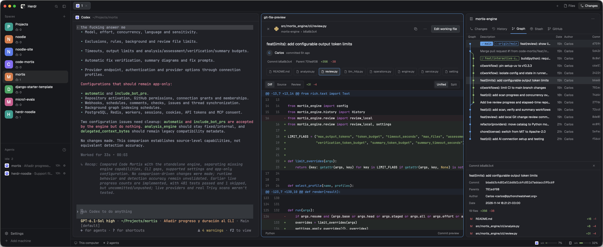

# Noodle

A compact coding workspace with agents nested under spaces in a Workspace tree sidebar, a Git-aware file browser, and one panel for Changes, History, Graph, Stash and GitHub. A three-line commit area uses small matching Commit and Generate buttons, while the bottom bar shows subscription usage through the person's existing CLI connections. The preview is a native Herdr capture with fictional demo content.



## What you see

- The window has no system title bar. On macOS, reserve traffic-light space at `[12, 16]`. Use Herdr's Paper theme in light appearance and Graphite in dark appearance; use theme names for surfaces and colors. Keep the person's UI and terminal fonts rather than shipping a global settings file.
- A 252 px sidebar, minimum 44 and maximum 480, has a 46 px brand row, one scrollable Workspace tree region, and a 44 px footer with Settings and Add machine side by side as icon-only buttons with tooltips. Keep the terminal and Git panel structure unchanged.
- Space rows are 40 px high with a 26 px colored initial avatar, name, live open-agent count (including idle and zero), and a fold chevron. Each space keeps its saved color, with a stable fallback for new spaces and contrasting initials. Separate nested agent rows from the space header by 5 px and a subtle one-pixel tree guide; use a quieter surface for the focused agent. Below an expanded space, indent 40 px agent rows showing task title, provider and status. Keep Working, Needs input, Finished, Idle and Unknown distinct; animate Working with the native spinner. Search spaces, agent titles and providers; expand matching groups and retain parent context for matching sub-agents. A global Needs your input shortcut focuses the first blocked agent or peeks its sub-agent. Each space expands independently: its chevron toggles without switching, and switching spaces opens the new one while preserving other expanded groups. Click the active space to fold it. Pins sort within their space. Tab and Enter/Space activate rows and pins. Live child terminals nest once, and children without panes open in a peek. Keep the native compact rail, machine groups, remote recovery/login guidance, worktree grouping, menus and drag reordering.
- The main work column has a 42 px tab strip and a work area with 8 px outer padding and gaps. Terminal panes have a 30 px header, 10 px corners, a one-pixel border that becomes the accent color when focused, and terminal padding `[14, 12]`. Frame a single pane too.
- A right panel, exported at 498 px wide with bounds 280–900, contains a Files/Changes stack. Show Changes initially; the tab bar toggles Files and Changes. Preserve the stable node IDs used by those controls.
- Files use 28 px tree rows, file-type/folder icons, and Git colors. Source and diff previews use a monospace font, line numbers, inline change gutters, and optional syntax colors. Markdown has Source/Diff and Preview modes, with a centered rendered document no wider than 760 px.
- The Git panel has a 40 px repository heading with an ellipsis actions menu, then a 38 px strip of labeled Changes, History, Graph and Stash tabs with an underline on the active tab. A separate 36 px summary shows file count and additions/deletions, with Stage all and its menu at the right. Changes has collapsible Staged changes and Changes groups; partially staged files appear in both, and each row opens the corresponding diff. Use 28 px file rows: status, file icon and filename at the left; muted parent directory, ellipsis menu and index checkbox at the right. Strike through deleted filenames. Show hover feedback on the repository selector and its rows.
- When more than one repository is found, turn the repository title into a native select-style popover with a chevron. Put the workspace name, repository count and Refresh inside it, followed by scrollable 32 px repository rows showing names, branches, changed-file counts, ahead/behind and conflict indicators. Keep selected-row styling and hover feedback on both the title trigger and repository rows. Keep the repository actions ellipsis at the far right of the header. Arrow keys navigate, Enter selects, Escape dismisses; selecting closes the popup. Use a plain title for zero or one repository, and open a single child automatically. Do not add a separate Repositories section.
- Put a 38 px branch/sync row directly above the commit area. Branch is left-aligned; show Publish with the upload icon when a committed branch has no available upstream, otherwise Pull (N) for incoming commits, Push (N) for outgoing commits, or Fetch, with the icon menu at the right. Use local upstream counts from the normal status read, without background fetching. If both directions have commits, Pull takes priority and stays fast-forward only. Fetch remains in the icon-decorated menu. Use small transparent controls with the same hover/focus language, not a wide highlight behind the branch.
- A one-pixel divider separates that toolbar from the darker `canvas` commit area, with 14 px padding. Start directly with the borderless 54 px text area (three rows at 18 px line height), without a COMMIT TO label. Below it, right-align **Commit all** or **Commit N files**, then **Generate**, with an 8 px gap. Both controls are 28 px high with a `raised` background, one-pixel theme border, 5 px corners, and 12 px normal-weight text. Generate has a sparkle icon and a joined 30 px model-menu segment with a chevron. Do not add a scope footer below the buttons. Disable Commit and Generate for unresolved conflicts.
- Below the commit area, add a 32 px row with the last commit subject and an Undo icon. Clicking the subject opens its details; Undo opens a compact confirmation, then soft-resets to the first parent after rechecking the repository, branch and HEAD. Preserve the index and working files, and restore the old message only into an unchanged empty draft. Never reset a real working repository during validation. The initial commit has no parent, so show it with Undo disabled. Cache commit metadata until HEAD changes.
- A 28 px status bar shows machine, current branch, and agent count at the left. At the right, provider icons precede short quota labels, 44×4 px bars, and percentages, with narrow separators between providers. Percentages below 70 use `ansi2`, 70–89 use `ansi3`, and 90–100 use `ansi1`. Detail meters use those same colors.

## How it behaves

- GitHub belongs in the same 38 px tab strip and uses the Git panel's theme, controls and spacing. Its Pull requests/Workflows switcher scopes reads to the selected repository through the user's `gh` sign-in. Keep the filterable list visible; an explicit row click opens or reuses a separate `changes-graph` preview pane in that tab. PR identity stays fixed above Overview, Checks and Reviews tabs. Refresh preserves the selection and detail tab without opening or focusing panes. PRs show grouped checks, review summaries and complete paginated inline threads; unresolved threads start expanded, resolved threads folded, and outdated locations are marked. Copy reviews/threads or all unresolved findings as Markdown with author, path, line, replies and links. Open an available reviewed commit in the shared read-only file preview; use the exact GitHub link for unavailable, outdated or left-side locations.
- New PR opens a retained-input composer with base branch, title, description and Draft checkbox. The settings icon immediately left of Generate opens separate PR instructions and template path settings, with Save and a top-right close control. Detect repository templates and accept an explicit relative/absolute UTF-8 file. Reuse the existing model picker and providers; generate only from committed branch changes against the chosen base, and reject changed branch/base/template/instructions/draft snapshots. Keep drafts per repository, machine and branch. Publishing/pushing stays a separate explicit action; creation verifies the remote head, supplies explicit head/base/body-file to `gh pr create`, and checks existing PRs after an uncertain failure to prevent duplicate submission.
- Network helpers bypass the document lock. Fetch lists on demand, 50 rows per page; fetch details and bounded logs only when requested. Poll active workflows every 15 seconds only while GitHub is visible, preserve last-good data on failure and reject stale responses. Keep text states out of render and avoid per-keystroke parent notifications. GitHub actions are limited to explicit PR creation; reviews and workflow runs are read-only. Creation/generation require a local checkout; remote browsing requires the helper bundle and gh there. Verify writes with fixtures, never by creating a PR or pushing a working branch as a UI test.

- Use Herdr's live agent states. **Working** uses the native rotating 12 px sidebar spinner. **Blocked** uses a compact exclamation mark or “Needs you” badge in the blocked color. **Done** is a filled dot until seen. **Idle** is an outlined ring. These are agent indicators, independent of Git and generation activity.
- Space clicks select the space; machine/worktree expansion, new spaces, context menus, and drag ordering keep the shipped space behavior. Do not reintroduce the discarded Better Sidebar layout or its agent tree.
- Folder rows expand lazily. Clicking a file opens or reuses `file-editor` beside the terminal, with native syntax highlighting and ⌘S / Ctrl+S save. Keep recovery drafts and reject stale saves. Changes and its tabs open `git-file-preview`, preserving its Diff/Source/Markdown modes. Follow the source terminal's folder when either pane has focus.
- In the focused editor or file preview, ⌘F / Ctrl+F opens literal, case-sensitive search. Enter / Shift+Enter and Next / Previous navigate with wraparound; Escape or Close closes find and clears search highlights. Keep ⌘S / Ctrl+S for saving. Search bindings belong to the mod's keyboard context, including its native inputs, without global key changes.
- Search Diff in both Unified and Split, Source, Review and rendered Markdown Preview. Keep the query when switching preview tabs, show the current/total count or No matches, and scroll to the active match. Preserve syntax colors, split columns and Review actions. Paint matches yellow and the current one orange, including while the find field has focus. Editor highlighting and rendered Markdown search require the native APIs below; Diff, Source and Review highlights use the existing mod renderers. Markdown search uses rendered words across formatting, including code and link labels, while keeping formatting and links; hidden link destinations and Markdown delimiters are not searched.
- Match the HTML prototype's shared preview: a 58 px path/repository header with Close, Copy path and a file menu; a 44 px toolbar with Diff/Source/Markdown tabs, insertion/deletion counts and Unified/Split; 24 px virtualized code rows with old/new line numbers and aligned split replacements. Keep theme colors and a compact language/line-ending footer. Render real commit metadata and horizontally scrollable file chips above the diff; keep commit Source/Markdown pinned to its revision, including deleted files. Empty commits still show their metadata.
- Route preview writes through Changes' existing action helpers, bound to the displayed repository, branch, HEAD and selection. Keep historical previews read-only. Preview menus include file history, stage/unstage, ignore/exclude and confirmed discard/Trash. Conflict review reads the current marker blocks, offers current/incoming/both and manually resolved content, then requires confirmation before writing and staging. Preserve surrounding text, diff3 blocks and line endings; reject stale file/index/HEAD, symlinks, binary files, malformed markers and files larger than 400,000 bytes.
- Refresh working-file previews only for relevant file/Git events or the periodic fallback, defer hidden tabs until shown, and reuse syntax colors when content is unchanged. Cache Files' tracked paths against the local index checksum; fall back to fresh reads for remote, unreadable, or zero-checksum indexes. Read OpenCode connections and quotas without spending statistics.
- Changed-file checkboxes stage/unstage real Git content. A partially staged file appears in both staged and working groups. The Stage All split control offers stage/unstage, stash viewing/applying, ignore operations, and explicitly confirmed restore/discard/Trash actions. Right-click each file for its individual actions, copying paths, opening diffs/source, and file history.
- Stash has its own tab, with Stash all, saved subjects/ages, bounded diff previews, Apply, Pop and confirmed Drop. Apply restores index state and keeps the stash; Pop drops only after applying succeeds. Re-read stash refs before mutation so a stale list cannot target a different stash. Keep confirmations bound to the original repository context. Never exercise these writes on the person's working repositories during validation.
- Select a repository to scope all Git operations, History/Graph, generation and previews. Keep drafts per repository/machine; do not switch repositories during a Git/generation operation. Remember selection per space and live terminal folder; Follow terminal clears it. Discover repository markers under that folder once per minute or with Refresh, including linked worktrees/submodules, without following directory symlinks or watching the entire workspace.
- **Commit with checked files** commits the existing index only, preserving unstaged hunks. **Commit with nothing checked** stages and commits all changes in the reviewed file list, including new/deleted files. Require a nonempty message. Reject stale branch or file selections and unresolved conflicts rather than guessing. Honor normal Git hooks, signing, and authentication.
- Changes is the working tree. History uses compact 28 px table rows with description, date, author and hash columns for up to 200 commits from HEAD, without branch/tag badges or a bottom count/branch footer. An upward arrow marks commits not reachable from the tracked remote branch; tooltips name that branch and say the status uses last fetched refs. Known synced commits have no badge; unknown or local-only upstreams have no status claim. Use bounded bulk reads, including in file history, rather than a Git call per row. Git Graph uses its original compact 28 px table rows with graph lanes, inline reference badges, description, date, author and hash columns. Clicking a commit opens its first changed file in the existing diff preview and shows commit details/file choices. The commit-detail file list uses the same 28 px height and zero gap between rows as Changes, with metadata spacing kept separate. File History filters History by that path.
- The branch control filters real local branches. When a typed, valid name does not exist, offer **Create Branch**, based on the current branch or HEAD. Validate with `git check-ref-format --branch`; create with `git switch --no-guess -c`, never by resetting an existing branch. Support keyboard arrows and Enter in the picker.
- Fetch directly runs fetch-all. The menu also provides Publish Branch, Fetch From, Pull (fast-forward), Pull (Rebase), Push, Push To, and explicitly confirmed Force Push with an exact lease. Publish uses push --set-upstream with the current branch and checked HEAD; honor branch.pushRemote, remote.pushDefault and branch.remote, otherwise prefer origin or a sole remote and ask for an ambiguous destination. Only the remote-action icon rotates during these operations. Keep branch, worktree, model and comparison-branch popup list heights steady while filtering; debounce Git branch-name validation and keep the pending creation row visible but disabled.
- Generate's right segment opens available connections, then a searchable model list. Remember the chosen connection/model per machine. The left segment fills the existing text area through that connection without committing. With checked files, use staged content for those paths; with none checked, use all working changes, including untracked files. Revalidate before and after generation, and preserve a newer user draft instead of replacing it.
- Only Generate's icon spins during commit-message generation. File staging and branch switching do not spin Fetch or Generate, change their labels, or dim unrelated controls. Coordinate conflicting actions through the busy guard while keeping the appearance steady.
- Failures use a compact `git-error` dialog with a clear title, visible details, and Close/Escape. Do not insert a large error block in the file list or hide details behind a disclosure.
- Usage refreshes every five minutes, scoped to the active machine (and project for OpenCode). Keep dated last-good readings on transient failure; clear removed/sign-out connections. Show expired quota windows as awaiting refresh, not synthetic zero. Put missing installations together at the end of the popup. No API estimate rows, account breakdown, billing note, or Commands shortcut appears in this footer.
- Use native `.spin(900)` for motion, never a redraw timer for a spinner. Existing Herdr shortcuts continue to work; editor save and editor/preview find bindings apply only inside their own keyboard contexts.

## Built from

`layouts/noodle.json` is this tree:

```text
root (row)
├── sidebar (column)
│   ├── brand: workspace-chrome
│   ├── sidebar-lists (column)
│   │   └── spaces: spaces-paths (spaces and nested agents)
│   └── sidebar-footer: spaces-paths {footer: true}
└── work (column)
    ├── tabs: tabs
    ├── work-body (row)
    │   ├── main: {tab: active, pane: framed terminal}
    │   └── panel (column)
    │       └── panel-body (stack)
    │           ├── files: files-browser
    │           └── changes: changes-graph
    └── status: workspace-usage
```

Ship seven personal mods:

| Mod | Responsibility |
| --- | --- |
| `spaces-paths` | Workspace tree, search, attention and compact footer; native space/machine/worktree behavior. |
| `files-browser` | Lazy folder tree, file-type icons, Git status, open the separate file editor. |
| `changes-graph` | Changes, staging/context menus, History/Graph, stash previews/actions, branch/remote actions, commits, generation. |
| `git-file-preview` | Source, colored diffs, change gutters, Review and rendered Markdown, with ⌘F / Ctrl+F search; receives a `selectionKey` prop. |
| `file-editor` | Local text editing, native syntax highlighting, ⌘F / Ctrl+F find, ⌘S / Ctrl+S save and recoverable drafts; receives its own `selectionKey`. |
| `git-error` | Error dialog; receives title/message/detail and overlay props. |
| `workspace-usage` | CLI usage collector, normalization, compact quota footer and details popup. |

Also install the complete `helpers/noodle/` directory at the same relative path under the destination Herdr home. It contains the shared document, recovery, file-operation, search, task, review and image helpers. Follow [INSTALL.md](INSTALL.md) and the layout, preview, mods and helpers declared in [manifest.json](manifest.json); the seven mod folders alone are insufficient.

Reuse shipped `workspace-chrome`, `tabs`, `pane`, and `menu` and their assets; program icons come from `icons/`. Reuse the shipped `worktree` dialog for New worktree. The shipped folders themselves are not bundled.

These are GPUI JavaScript views, not HTML, React DOM, or Node programs. Use `gpui-kit`, `gpui-base`, and the installed `herdr.d.ts`/`gpui-kit.d.ts` API. UI uses `spaces`, `machines`, `agents`, `panes`, `focused`, `theme`, `settings`, `layout`, `props`, `shared`/`setShared`, `exec`, `hc`, `readTextFile`, and `watchFolder`. Use Herdr commands for space/terminal/machine operations and `pane.split`/`pane.focus` to open previews. Git errors use `openOverlay`/`closeOverlay`.

Runtime programs are Git, Python 3.9+, `sh`, `rg` for Quick Open/content search, and optionally `bash`/`bat` for preview syntax colors. PR / CI requires `gh` signed in by the user. Image previews use macOS's `sips` and `qlmanage`; Reveal in Finder uses `open -R`. Terminal tasks use Herdr's `hc`. Usage calls installed Codex, Claude, OpenCode, or Kiro CLIs. Generation uses Codex's ephemeral CLI invocation or OpenCode's stateless text-generation API through its CLI. No pip packages or account files are installed or exported. See [connection notes](mods/workspace-usage/CONNECTIONS.md) and [NOTICE.md](NOTICE.md).

`layouts/noodle.png` is the Settings preview. `preview.png` is the same sanitized native demo capture for the recipe/README. The temporary preview-only mod and demo layout are not part of the installable bundle.

## Watch out

- Tested against Herdr 0.1.15; use the current installed type declarations when adapting to another release. Generated declarations and editor configuration are intentionally omitted. Never change Herdr's shipped files; these custom folders are personal clones.
- Never overwrite existing names on someone else's machine. The installing agent must resolve collisions before copying files, following the local Herdr `AGENTS.md`. If renaming a mod, change layout references, self-opening overlay names, asset paths, and Python helper paths together.
- Preserve node IDs (`sidebar`, `spaces`, `tabs`, `main`, `panel`, `panel-body`, `files`, `changes`, `status`) because shipped controls address them. Do not copy `shared.json`, workspace documents, click-state files, keys, or global settings.
- macOS with Herdr 0.1.15 is the tested full installation. Linux is not fully validated and the current image/Finder adapters require macOS. Windows is unsupported by the full package: Python helpers use Unix `fcntl` and `os.fchmod`, despite the PowerShell folder-listing adapter. Local editing, search, tasks, Review and asset helpers do not run on remote machines; remote Git features require the relevant programs there. See [INSTALL.md](INSTALL.md).
- Editing, syntax highlighting, saving and selection-only editor find work without native patches. Highlighting every editor match requires `EditorState.search(query, direction)` and `close_search()`. Rendered Markdown search requires `TextViewState.markdown(text)`, `TextView.new(state)` and the state's `search`, `status`, `close_search` and `release` methods. Without that bridge Markdown still renders; use Source to search it, since the legacy Preview find field may report No matches for visible text. Diff, Source and Review search do not require native search patches. Verify generated declarations and runtime capabilities, not just the version or initial render.
- Git gutter marks inside the writable editor require `EditorState.set_gutter_marks`; skip them when the API is absent. Source preview marks do not need that API. For a separately requested native build, use `herdrdev/herdr-app` commit `48ddb41ce4ba07073a6a4283f44608ac93644368` with its submodules initialized. Apply `herdr-gutter.patch`, then `herdr-search-highlights.patch`, then `herdr-preview-search.patch`, checking each before applying it. The older `herdr-editor.patch` is not part of that sequence. The tested macOS build uses Rust 1.95.0, Zig 0.16.0, locked dependencies, `CARGO_PROFILE_DEV_DEBUG=0` and Cargo package overrides keeping `quickjs-jit-macro` debug info (`debug=2`, `strip="none"`). Follow the source checkout's build prerequisites and [native build procedure](INSTALL.md#optional-native-development-build); patches may need adaptation for another revision. Keep the signed release intact, test in an isolated home/core session, and reopen the main window with a development app only when explicitly requested. Native builds are not a normal layout installation step; see [native/README.md](native/README.md).
- History and Graph stop at 200 commits. Changes shows at most 1,000 file rows. Files lists at most 500 entries per folder and 5,000 in total. Source previews are bounded at 5,000 lines/400,000 characters; diff previews at 1,500 lines; Markdown at 200,000 characters. Host file reads have Herdr's own size limit.
- Repository discovery uses Python/Git read-only, with a four-level, 2,000-directory, 64-repository and eight-second budget. Skip dependency/build/cache folders. Report limits and read failures instead of showing an unavailable status as clean. Sync counts use local upstream refs without fetching. Remote discovery runs on the space's machine; Windows/remote integration still needs platform validation.
- Generation keeps one context line per diff hunk and permits up to 1,200,000 UTF-8 bytes without truncating changes. OpenCode's encoded body is also bounded at 1,200,000 bytes and sent to its authenticated loopback service. Keep source out of process arguments, disable proxies and redirects, and read its service password only from OpenCode's existing state. Errors report actual bytes and the limit, with a smaller staged-selection recovery. Generation is not streamed. Slow models may take time before text appears; keep the label unchanged with the spinner only on Generate. Do not mistake global busy state for an active Fetch, Commit, or generation request.
- Usage availability differs from generation availability. Kiro reads monthly credits and the reset date using `kiro-cli chat --no-interactive /usage --v2`, tested with IAM Identity Center KIRO POWER. Unsupported reports fail without invented usage. This text interface may change and can create empty CLI sessions per refresh. Claude usage uses an internal interface; Claude/Kiro generation is not implemented. OpenCode Go limits need Console account metadata in addition to the Go connection. Its model list and credentials remain managed by OpenCode.
- Source is sent only when the person generates a message. OpenCode generation sends JSON directly to its existing authenticated local service; source never enters process arguments. Codex uses stdin in an ephemeral neutral folder. Do not introduce a silent provider fallback or copy secrets into Herdr.
- A successful `herdr-app check` only covers the initial render. Try the menus, async responses, previews, and selected-file operations in the app too. Do not validate commits, force pushes, or restore/discard operations on a real working repository.

## Done when

1. `herdr-app check` passes for every included mod; switching to `noodle` shows the layout without runtime errors.
2. A fresh configuration install copies the layout, Settings thumbnail, seven mods and the complete `helpers/noodle/` directory from the manifest. A conflicting name leaves all existing files untouched. Generated runtime state and credentials are not copied.
3. The sidebar shows live counts beside compact avatars, nests agents under spaces, filters across spaces, and focuses blocked agents through the attention shortcut. Folding, pins, child peeks, keyboard activation, remote groups, reordering and the compact rail work; native working/blocked/done/idle states remain distinct.
4. Files opens the separate file editor, with syntax highlighting and ⌘S / Ctrl+S save. Changes, History/Graph and Stash keep the same diff component. Source and diff content remain bounded and the active repository follows the original terminal.
   Check find in the editor, Unified/Split Diff, Source, Review and Markdown Preview using repeated words and offscreen matches. Verify both navigation shortcuts, buttons, wraparound, no-match feedback, Escape, query retention across preview tabs and preserved syntax/Markdown formatting. Expect selection-only editor find and no rendered Markdown search without the bridges; with them, verify yellow/orange highlights while the find field is focused. Search covers only loaded content within the documented limits. For native builds, both `native/search-check` and `native/markdown-search-check` must pass under the development executable, followed by visual checks in the app.
5. In a disposable Git repository, checked files commit only staged content; an unchecked set commits all current new/modified/deleted files; partially staged hunks remain intact.
6. History has no ref badges, Graph does, and creating a valid missing branch does not reset existing branches or overwrite dirty files.
7. Commit and Generate match at 28 px height, appear in that order at the right, and the three-line text area is borderless on the darker surface below the divider.
8. Selecting files leaves Fetch, Generate, and branch appearance steady. Only remote actions spin Fetch; only message generation spins Generate. A newer draft survives a late response.
9. Signed-in supported connections expose their actual models and quotas, absent providers group at the end, and stale/unsupported readings never become invented zeros. A generated message appears without a commit being made.
10. The shareable folder contains no machine-specific runtime state, secrets, personal paths, or terminal history. Its preview is explicitly demo data.
