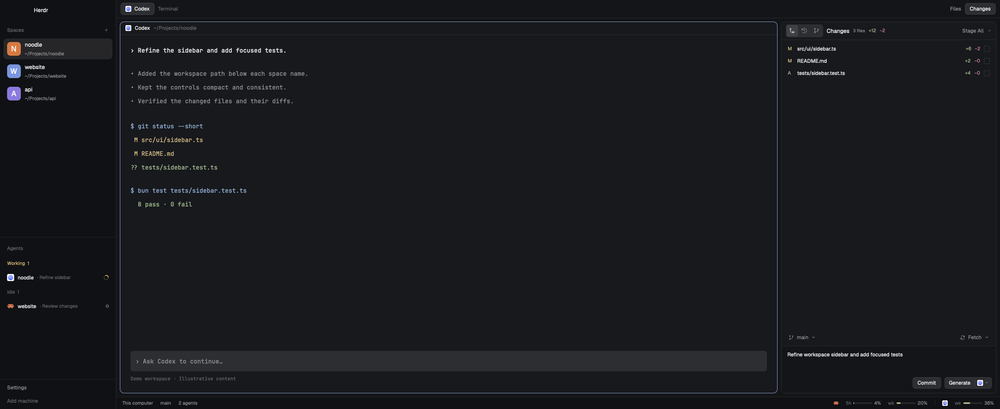

# Noodle

A compact coding workspace with per-space agent counts in the sidebar, a separate agents list, a Git-aware file browser, and one panel for Changes, History, and Git Graph. A three-line commit area uses small matching Commit and Generate buttons, while the bottom bar shows subscription usage through the person's existing CLI connections. The preview is a native Herdr capture with fictional demo content.



## What you see

- The window has no system title bar. On macOS, reserve traffic-light space at `[12, 16]`. Use Herdr's Paper theme in light appearance and Graphite in dark appearance; use theme names for surfaces and colors. Keep the person's UI and terminal fonts rather than shipping a global settings file.
- A 268 px sidebar, minimum 44 and maximum 480, has a 46 px brand row, resizable Spaces and Agents regions, and a 69 px Settings/Add machine footer. Spaces and Agents have a 90 px minimum each. This exported arrangement uses weights 1.20968 and 0.7903201.
- Space rows show a 32 px rounded initial avatar beside the name and a second, smaller line with the shipped robot icon (`icons/agent.svg`) and the number of open agents in that space, including idle agents and zero. The narrow sidebar becomes a rail. Machine and worktree groups follow Herdr's existing spaces model.
- The main work column has a 42 px tab strip and a work area with 8 px outer padding and gaps. Terminal panes have a 30 px header, 10 px corners, a one-pixel border that becomes the accent color when focused, and terminal padding `[14, 12]`. Frame a single pane too.
- A right panel, exported at 498 px wide with bounds 280–900, contains a Files/Changes stack. Show Changes initially; the tab bar toggles Files and Changes. Preserve the stable node IDs used by those controls.
- Files use 28 px tree rows, file-type/folder icons, and Git colors. Source and diff previews use a monospace font, line numbers, inline change gutters, and optional syntax colors. Markdown has Source/Diff and Preview modes, with a centered rendered document no wider than 760 px.
- The Git panel's 42 px header holds Changes, History, and Git Graph icons, the title, file count, additions/deletions, and Stage All at the right. Changed files use 28 px rows, a status letter at the left, counts and a staging checkbox at the right. Strike through deleted filenames.
- When more than one repository is found, show a collapsible Repositories section above that header inside the same panel: a 36 px heading with Refresh, up to 180 px of scrollable 32 px rows, branch names, changed-file counts, ahead/behind and conflict indicators. Hide the entire section for zero or one repository; open a single child repository automatically. Show the selected repository and the commit target. Keep the terminal in the central work area.
- Put a 38 px branch/Fetch row directly above the commit area. Branch is left-aligned; Fetch and its menu are right-aligned. Use small transparent controls with the same hover/focus language, not a wide highlight behind the branch.
- A one-pixel divider separates that toolbar from the darker `canvas` commit area. The text area is borderless, 54 px high, three rows at 18 px line height. Below it, right-align **Commit**, then **Generate**, with an 8 px gap. Both controls are 26 px high with a `raised` background, one-pixel theme border, 6 px corners, and 12 px normal-weight text. Generate is a joined split button: action on the left, connection icon and small chevron on a 38 px right segment.
- A 28 px status bar shows machine, current branch, and agent count at the left. At the right, provider icons precede short quota labels, 44×4 px bars, and percentages, with narrow separators between providers. Percentages below 70 use `ansi2`, 70–89 use `ansi3`, and 90–100 use `ansi1`. Detail meters use those same colors.

## How it behaves

- Use Herdr's live agent states. **Working** uses the native rotating 12 px sidebar spinner. **Blocked** uses a compact exclamation mark or “Needs you” badge in the blocked color. **Done** is a filled dot until seen. **Idle** is an outlined ring. These are agent indicators, independent of Git and generation activity.
- Space clicks select the space; machine/worktree expansion, new spaces, context menus, and drag ordering keep the shipped space behavior. Do not reintroduce the discarded Better Sidebar layout or its agent tree.
- Folder rows expand lazily. Clicking a file opens or reuses `git-file-preview` beside the terminal. Markdown Preview renders the selected document; Source/Diff returns to the shared source/diff component. Follow the source terminal's folder when the preview has focus.
- Refresh working-file previews only for relevant file/Git events or the periodic fallback, defer hidden tabs until shown, and reuse syntax colors when content is unchanged. Cache Files' tracked paths against the local index checksum; fall back to fresh reads for remote, unreadable, or zero-checksum indexes. Read OpenCode connections and quotas without spending statistics.
- Changed-file checkboxes stage/unstage real Git content. A partially staged file has a mixed indicator. The Stage All split control offers stage/unstage, stash viewing/applying, ignore operations, and explicitly confirmed restore/discard/Trash actions. Right-click each file for its individual actions, copying paths, opening diffs/source, and file history.
- Select a repository to scope all Git operations, History/Graph, generation and previews. Keep drafts per repository/machine; do not switch repositories during a Git/generation operation. Remember selection per space and live terminal folder; Follow terminal clears it. Discover repository markers under that folder once per minute or with Refresh, including linked worktrees/submodules, without following directory symlinks or watching the entire workspace.
- **Commit with checked files** commits the existing index only, preserving unstaged hunks. **Commit with nothing checked** stages and commits all changes in the reviewed file list, including new/deleted files. Require a nonempty message. Reject stale branch or file selections and unresolved conflicts rather than guessing. Honor normal Git hooks, signing, and authentication.
- Changes is the working tree. History lists up to 200 commits from HEAD without branch/tag badges. Git Graph lists up to 200 commits across refs with graph lanes and reference badges. Clicking a commit opens its first changed file in the existing diff preview and shows commit details/file choices. File History filters History by that path.
- The branch control filters real local branches. When a typed, valid name does not exist, offer **Create Branch**, based on the current branch or HEAD. Validate with `git check-ref-format --branch`; create with `git switch --no-guess -c`, never by resetting an existing branch. Support keyboard arrows and Enter in the picker.
- Fetch directly runs fetch-all. Its menu provides Fetch From, Pull (fast-forward), Pull (Rebase), Push, Push To, and explicitly confirmed Force Push with an exact lease. Keep the Fetch label fixed; only its icon rotates during actions from this control/menu.
- Generate's right segment opens available connections, then a searchable model list. Remember the chosen connection/model per machine. The left segment fills the existing text area through that connection without committing. With checked files, use staged content for those paths; with none checked, use all working changes, including untracked files. Revalidate before and after generation, and preserve a newer user draft instead of replacing it.
- Only Generate's icon spins during commit-message generation. File staging and branch switching do not spin Fetch or Generate, change their labels, or dim unrelated controls. Coordinate conflicting actions through the busy guard while keeping the appearance steady.
- Failures use a compact `git-error` dialog with a clear title, visible details, and Close/Escape. Do not insert a large error block in the file list or hide details behind a disclosure.
- Usage refreshes every five minutes, scoped to the active machine (and project for OpenCode). Keep dated last-good readings on transient failure; clear removed/sign-out connections. Show expired quota windows as awaiting refresh, not synthetic zero. Put missing installations together at the end of the popup. No API estimate rows, account breakdown, billing note, or Commands shortcut appears in this footer.
- Use native `.spin(900)` for motion, never a redraw timer for a spinner. Existing Herdr shortcuts continue to work; there are no package-specific key overrides.

## Built from

`layouts/noodle.json` is this tree:

```text
root (row)
├── sidebar (column)
│   ├── brand: workspace-chrome
│   ├── sidebar-lists (column)
│   │   ├── spaces: spaces-paths
│   │   └── agents: agents
│   └── sidebar-footer: workspace-chrome {footer: true}
└── work (column)
    ├── tabs: tabs
    ├── work-body (row)
    │   ├── main: {tab: active, pane: framed terminal}
    │   └── panel (column)
    │       └── panel-body (stack)
    │           ├── files: files-browser
    │           └── changes: changes-graph
    └── status: workspace-usage
```

Ship six personal mods:

| Mod | Responsibility |
| --- | --- |
| `spaces-paths` | Two-line space rows; shipped space/machine/worktree behavior. |
| `files-browser` | Lazy folder tree, file-type icons, Git status, open file previews. |
| `changes-graph` | Changes, staging/context menus, History/Graph, branch/remote actions, commits, generation. |
| `git-file-preview` | Source, colored diffs, change gutters, rendered Markdown; receives a `selectionKey` prop. |
| `git-error` | Error dialog; receives title/message/detail and overlay props. |
| `workspace-usage` | CLI usage collector, normalization, compact quota footer and details popup. |

Reuse shipped `workspace-chrome`, `agents`, `tabs`, `pane`, and `menu` and their assets; program icons come from `icons/`. The shipped menu may open other shipped Herdr dialogs, including worktree dialogs. The shipped folders themselves are not bundled.

These are GPUI JavaScript views, not HTML, React DOM, or Node programs. Use `gpui-kit`, `gpui-base`, and the installed `herdr.d.ts`/`gpui-kit.d.ts` API. UI uses `spaces`, `machines`, `agents`, `panes`, `focused`, `theme`, `settings`, `layout`, `props`, `shared`/`setShared`, `exec`, `hc`, `readTextFile`, and `watchFolder`. Use Herdr commands for space/terminal/machine operations and `pane.split`/`pane.focus` to open previews. Git errors use `openOverlay`/`closeOverlay`.

Runtime programs are Git, Python 3, platform shell tools (`sh`, or Windows PowerShell for directory listing), and optionally `bash`/`bat` for highlighting. Usage calls installed Codex, Claude, OpenCode, or Kiro CLIs. Generation uses Codex's ephemeral CLI invocation or OpenCode's stateless text-generation API through its CLI. No account files are installed or exported. See [connection notes](mods/workspace-usage/CONNECTIONS.md) and [NOTICE.md](NOTICE.md).

`layouts/noodle.png` is the Settings preview. `preview.png` is the same sanitized native demo capture for the recipe/README. The temporary preview-only mod and demo layout are not part of the installable bundle.

## Watch out

- Tested against Herdr 0.1.15; use the current installed type declarations when adapting to another release. Generated declarations and editor configuration are intentionally omitted. Never change Herdr's shipped files; these custom folders are personal clones.
- Never overwrite existing names on someone else's machine. The installing agent must resolve collisions before copying files, following the local Herdr `AGENTS.md`. If renaming a mod, change layout references, self-opening overlay names, asset paths, and Python helper paths together.
- Preserve node IDs (`sidebar`, `spaces`, `agents`, `tabs`, `main`, `panel`, `panel-body`, `files`, `changes`, `status`) because shipped controls address them. Do not copy `shared.json`, workspace documents, click-state files, keys, or global settings.
- Python 3.9+ is required for usage, generation, ignore helpers, and Trash handling. Remote-machine operations require the relevant programs there too. Trash is implemented for macOS/Linux only. The file browser handles Windows listing, but no complete Windows/remote validation is claimed.
- History and Graph stop at 200 commits. Changes shows at most 1,000 file rows. Files lists at most 500 entries per folder and 5,000 in total. Source previews are bounded at 5,000 lines/400,000 characters; diff previews at 1,500 lines; Markdown at 200,000 characters. Host file reads have Herdr's own size limit.
- Repository discovery uses Python/Git read-only, with a four-level, 2,000-directory, 64-repository and eight-second budget. Skip dependency/build/cache folders. Report limits and read failures instead of showing an unavailable status as clean. Sync counts use local upstream refs without fetching. Remote discovery runs on the space's machine; Windows/remote integration still needs platform validation.
- Large generation input over 60,000 UTF-8 bytes is refused with a smaller-selection message. Generation is not streamed. Slow models may take time before text appears; keep the label unchanged with the spinner only on Generate. Do not mistake global busy state for an active Fetch, Commit, or generation request.
- Usage availability differs from generation availability. Kiro reads monthly credits and the reset date using `kiro-cli chat --no-interactive /usage --v2`, tested with IAM Identity Center KIRO POWER. Unsupported reports fail without invented usage. This text interface may change and can create empty CLI sessions per refresh. Claude usage uses an internal interface; Claude/Kiro generation is not implemented. OpenCode Go limits need Console account metadata in addition to the Go connection. Its model list and credentials remain managed by OpenCode.
- Source is sent only when the person generates a message. OpenCode's current API CLI puts its JSON request body in process arguments, visible to local process inspection. Codex uses stdin in an ephemeral neutral folder. Do not introduce a silent provider fallback or copy secrets into Herdr.
- A successful `herdr-app check` only covers the initial render. Try the menus, async responses, previews, and selected-file operations in the app too. Do not validate commits, force pushes, or restore/discard operations on a real working repository.

## Done when

1. `herdr-app check` passes for every included mod; switching to `noodle` shows the layout without runtime errors.
2. A fresh configuration install creates only the layout/preview and six mods. A conflicting name leaves all existing files untouched.
3. The sidebar displays a robot icon and live open-agent counts below names with a 32 px avatar; native agent working/blocked/done/idle states remain distinct.
4. Files opens source and Markdown. Changes and History/Graph open the same diff component. Source and diff content remain bounded and the active repository follows the original terminal.
5. In a disposable Git repository, checked files commit only staged content; an unchecked set commits all current new/modified/deleted files; partially staged hunks remain intact.
6. History has no ref badges, Graph does, and creating a valid missing branch does not reset existing branches or overwrite dirty files.
7. Commit and Generate match at 26 px height, appear in that order at the right, and the three-line text area is borderless on the darker surface below the divider.
8. Selecting files leaves Fetch, Generate, and branch appearance steady. Only remote actions spin Fetch; only message generation spins Generate. A newer draft survives a late response.
9. Signed-in supported connections expose their actual models and quotas, absent providers group at the end, and stale/unsupported readings never become invented zeros. A generated message appears without a commit being made.
10. The shareable folder contains no machine-specific runtime state, secrets, personal paths, or terminal history. Its preview is explicitly demo data.
